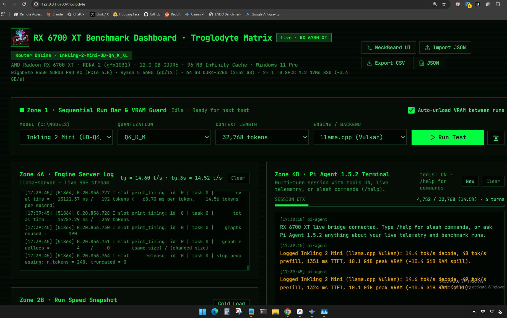
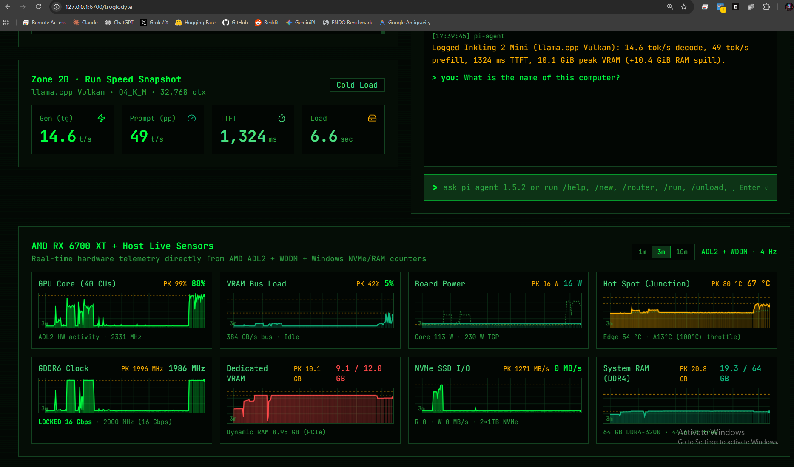

# Inkling 2 Mini on RX 6700 XT: live dashboard capture (2026-11-25)

Supplemental reference. Two screenshots of the Troglodyte dashboard (`/troglodyte`) during a cold-load run.

- Model: Inkling-2-Mini-UD-Q4_K_XL, llama.cpp (Vulkan), 32,768 ctx
- Result: ~14.6 t/s decode, ~49 t/s prefill, 1,324 ms TTFT, 6.6 s load
- Memory: ~10.1 GiB peak VRAM, ~10.4 GiB RAM spill (Pi agent log)
- Sensors: GPU junction 67 C (peak 80 C), board power ~16 W (idle) with 113 W core peak, VRAM 9.1 / 12 GB at capture

Single run, single machine, not a controlled benchmark. Numbers are as displayed by the dashboard.

